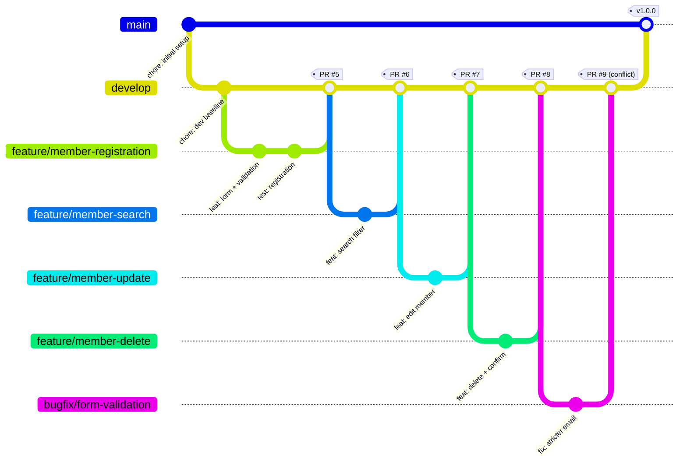
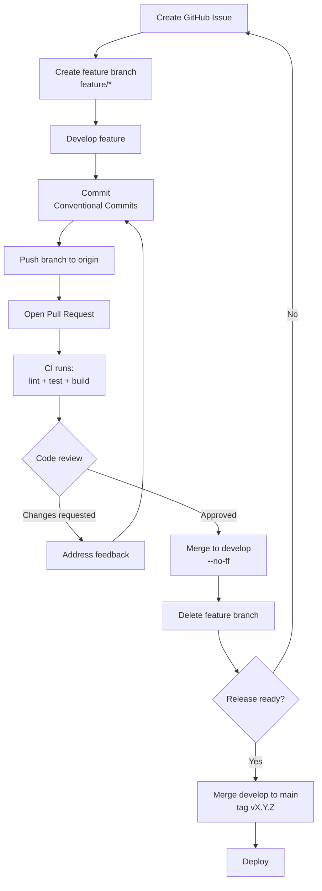
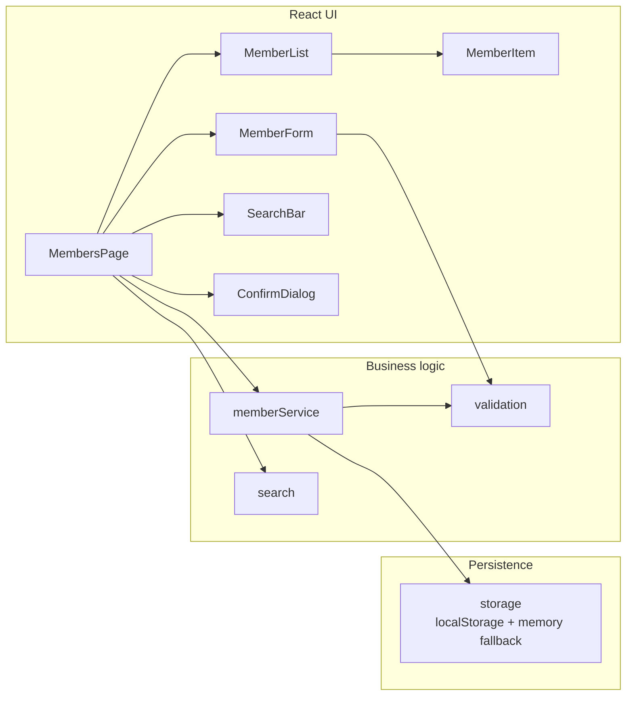

# Member Management Demo

A deliberately small **Member Management** application built to demonstrate a
**professional Git and GitHub team workflow** — branching strategy, pull
requests, code review, conflict resolution, CI, and documentation.

> The application is intentionally simple (CRUD on members). The point of this
> repository is **how the code is built and shipped**, not the app itself.

---

## Project Overview

The app lets a user **create, view, edit, and delete** members. It is built with
React + Vite and tested with Vitest. Every feature was delivered through the same
lifecycle a real team uses: issue → feature branch → commits → pull request →
review → merge.

See [`docs/`](docs/) for the full workflow evidence (PRs, reviews, conflict
resolution) and [`docs/diagrams/`](docs/diagrams/) for the branching and
lifecycle diagrams.

## Features

| Feature | Description | Delivered in |
| --- | --- | --- |
| Create member | Form with validation + duplicate-email guard | PR #5 |
| Search members | Case-insensitive filter on name/email/role | PR #6 |
| Edit member | Reuses the form in edit mode | PR #7 |
| Delete member | Confirmation dialog before removal | PR #8 |
| Stricter validation | Hardened email rule (bugfix + conflict resolution) | PR #9 |

## Technologies Used

| Layer | Tech |
| --- | --- |
| Frontend | React 18, Vite 5 |
| Language | JavaScript (ES2022) |
| Testing | Vitest, Testing Library, jsdom |
| Quality | ESLint |
| CI | GitHub Actions |
| Persistence | `localStorage` with in-memory fallback |

## Installation

```bash
git clone https://github.com/luigi043/member-management-demo.git
cd member-management-demo
npm ci
```

## Usage

```bash
npm run dev       # start the dev server (Vite)
npm test          # run unit tests once
npm run test:watch
npm run lint      # run ESLint
npm run build     # production build
```

## Project Structure

```
member-management-demo/
├── .github/
│   ├── ISSUE_TEMPLATE/
│   ├── pull_request_template.md
│   └── workflows/ci.yml
├── src/
│   ├── components/   # presentational React components
│   ├── pages/        # MembersPage orchestrator
│   ├── services/     # CRUD business logic
│   └── utils/        # validation, search, storage (pure, testable)
├── tests/            # Vitest unit tests
├── docs/
│   ├── workflow/     # branching, commits, reviews, conflict resolution
│   └── diagrams/     # Mermaid git-flow / lifecycle / architecture
├── scripts/          # reproducible git-history builder
├── README.md
├── CONTRIBUTING.md
└── LICENSE
```

## Git Workflow

This project uses **GitHub Flow with a `develop` integration branch**:

```
main      ← production-ready, tagged releases
  ↑ (release merge)
develop   ← integration branch, always green
  ↑ (PR merge --no-ff)
feature/* , bugfix/*   ← short-lived branches, one per issue
```

Full details: [`docs/workflow/branching-strategy.md`](docs/workflow/branching-strategy.md)
and [`docs/workflow/git-workflow.md`](docs/workflow/git-workflow.md).

### Commit convention

[Conventional Commits](https://www.conventionalcommits.org/): `feat:`, `fix:`,
`docs:`, `test:`, `refactor:`, `chore:`. See
[`docs/workflow/commit-conventions.md`](docs/workflow/commit-conventions.md).

## Diagrams

The diagrams below render automatically on GitHub. Source files live in
[`docs/diagrams/`](docs/diagrams/) and can also be viewed at
[mermaid.live](https://mermaid.live).

### Branching model

[`docs/diagrams/git-flow.mmd`](docs/diagrams/git-flow.mmd)



### Feature lifecycle

[`docs/diagrams/lifecycle.mmd`](docs/diagrams/lifecycle.mmd)



### Application architecture

[`docs/diagrams/architecture.mmd`](docs/diagrams/architecture.mmd)



## Reproducing the Git History

Run a simulated branch/merge rehearsal in a new disposable directory (Git Bash on Windows, Bash on Linux/macOS):

```bash
bash scripts/build-git-history.sh
git -C <printed-rehearsal-directory> log --oneline --graph --all
```

The script copies source assets, excludes Git metadata and dependencies, and never modifies this repository or configures a remote. An explicit output path must not exist. This creates `main` + `develop` + feature/bugfix branches, conventional commits
from a simulated three-person team, `--no-ff` merges for every PR, a real merge
**conflict that is resolved**, and a tagged `v1.0.0` release.

## Contributors

Simulated team for this demonstration:

| Name | Role |
| --- | --- |
| Maya Santos | Team lead / reviewer |
| Liam Costa | Developer |
| Noah Almeida | Developer |

## License

[MIT](LICENSE).

## Classroom walkthrough and current verification

See [the reproducible walkthrough](docs/workflow/classroom-walkthrough.md) for
setup, acceptance checks, history inspection, and a safe conflict rehearsal.
The team names, PR numbers and review conversations in the original records are
**simulated course evidence**, not independently verified hosted GitHub reviews.
The existing commit graph is real local Git history. GitHub Actions reports checks;
branch protection must be configured separately to enforce required checks.

Current work is on `fix/safe-workflow-rehearsal`, based on `develop`.
See [the local review](docs/workflow/pull-requests/local-completion-review.md).

Test output images and the Word report: [Demo5 Test Evidence](docs/test-evidence/Demo5-Test-Evidence.docx). Original PNG and TXT records are alongside the document.
